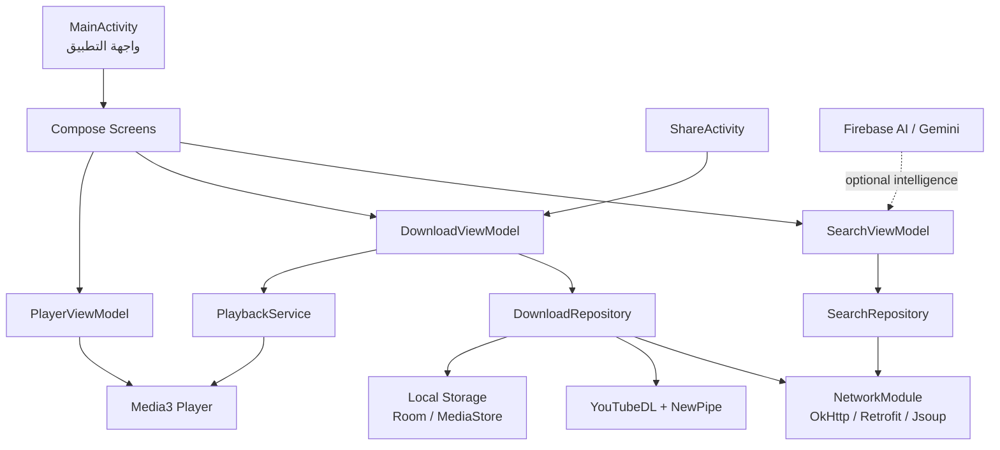

# Cove

تطبيق Android عربي لتنزيل الوسائط وتشغيلها وإدارتها بواجهة Material 3 حديثة، مع دعم البحث، استخراج روابط الوسائط، التنزيل المحلي، التشغيل، والمشاركة.

> هذا المستودع مستقل بذاته. أي تكامل مع Gemini داخل التطبيق يُدار من خلال إعدادات التطبيق وخدمات Firebase/Google الاعتيادية.

## خريطة النظام



## مكوّنات المشروع

| المسار | المسؤولية |
| --- | --- |
| `app/src/main/java/com/example/MainActivity.kt` | نقطة دخول التطبيق وتكوين واجهة Compose والتنقل |
| `app/src/main/java/com/example/BrowserScreen.kt` | شاشة التصفح وعرض المحتوى |
| `app/src/main/java/com/example/SearchScreen.kt` | واجهة البحث والنتائج |
| `app/src/main/java/com/example/PlayerScreen.kt` | واجهة تشغيل الفيديو والصوت |
| `app/src/main/java/com/example/DownloadViewModel.kt` | حالات التنزيل، التحقق من الروابط، والإشعارات |
| `app/src/main/java/com/example/DownloadRepository.kt` | استخراج معلومات الوسائط وتنفيذ التنزيلات |
| `app/src/main/java/com/example/SearchViewModel.kt` | إدارة البحث والاقتراحات وحالات الواجهة |
| `app/src/main/java/com/example/data/SearchRepository.kt` | طبقة الوصول إلى بيانات البحث والمصادر الخارجية |
| `app/src/main/java/com/example/api/NetworkModule.kt` | إعداد عميل الشبكة وطلبات HTTP |
| `app/src/main/java/com/example/api/OkHttpDownloader.kt` | موفّر الشبكة المستخدم مع أدوات استخراج الوسائط |
| `app/src/main/java/com/example/PlaybackService.kt` | خدمة التشغيل في الخلفية عبر Media3 |
| `app/src/main/java/com/example/download/DownloadWorker.kt` | تنفيذ التنزيل داخل WorkManager (يستمر بعد إغلاق التطبيق أو قفل الشاشة) |
| `app/src/main/java/com/example/download/DownloadScheduler.kt` | جدولة/إلغاء مهام التنزيل وسياسة إعادة المحاولة التلقائية |
| `app/src/main/java/com/example/download/DownloadNotifications.kt` | إشعار التقدّم الحي وإشعارات الاكتمال/الفشل |
| `app/src/main/java/com/example/data/DownloadRepository.kt` | محرّك التنزيل (استخراج، استئناف، تليمتري التقدّم) |
| `app/src/main/java/com/example/ShareActivity.kt` | استقبال الروابط من قائمة مشاركة Android |
| `app/src/main/java/com/example/ui/theme/` | الألوان، الخطوط، والنظام البصري |
| `app/src/main/res/` | الموارد، الأيقونات، التخطيطات، والخطوط العربية |
| `DESIGN_SPEC.md` | مواصفات التصميم والهوية البصرية |
| `SCREEN_INVENTORY.md` | جرد الشاشات والحالات التفاعلية |

## تدفق العمل الرئيسي

1. يستقبل المستخدم رابطًا أو عبارة بحث من الواجهة.
2. يمر الطلب عبر `ViewModel` المناسب لإدارة الحالة بشكل آمن.
3. تستخدم طبقة البيانات أدوات الشبكة والاستخراج للحصول على معلومات الوسائط.
4. يعرض التطبيق العنوان، الصورة المصغرة، الصيغ المتاحة، والمدّة.
5. ينفّذ `DownloadRepository` التنزيل ويحفظ النتيجة في مساحة تخزين Android.
6. يرسل التطبيق إشعار النجاح أو الخطأ، ويمكن تشغيل الملف من خلال Media3.
7. يمكن استقبال الروابط مباشرة عبر `ShareActivity`.

## التنزيل في الخلفية والإشعارات

منذ إدخال WorkManager لم يعد التنزيل مرتبطًا بدورة حياة الواجهة:

1. عند طلب تنزيل يُسجَّل العنصر فورًا في `DownloadRepository.downloadsFlow` (ليظهر في «ملفاتي» لحظيًا) ثم تُجدول مهمة `DownloadWorker` باسم فريد مرتبط بمعرّف العنصر.
2. يعمل الـ Worker كخدمة أمامية من نوع `dataSync` طوال مدة التنزيل، فيستمر بعد قفل الشاشة أو إغلاق التطبيق، ويُعاد تشغيله تلقائيًا بعد إعادة تشغيل الجهاز.
3. تُنقل لحظات التقدّم عبر `DownloadTelemetry` (نسبة، سرعة، وقت متبقٍ، الحجم) إلى:
   - إشعار حي بشريط تقدّم (`res/layout/notification_download_progress.xml`) مع زر **إلغاء**.
   - حقول `DownloadItem` في الـ StateFlow، فتتحدّث شاشة «ملفاتي» بالتوازي مع الإشعار.
4. عند حدوث خطأ شبكي مؤقت يعيد WorkManager المحاولة تلقائيًا بسياسة `BackoffPolicy.EXPONENTIAL` (حتى 3 محاولات) قبل عرض أي رسالة فشل.
5. التنزيل المباشر يدعم **الاستئناف** عبر ترويسة `Range`، فلا يُعاد تحميل ما تم تنزيله بالفعل.

## المتطلبات

- Android Studio حديث مع دعم Kotlin وJetpack Compose.
- JDK 11 أو أحدث متوافق مع إعدادات Gradle.
- Android SDK وفق قيمة `compileSdk` في `app/build.gradle.kts`.
- جهاز Android أو محاكي بإصدار Android 7.0 (API 24) أو أحدث.
- اتصال بالإنترنت لعمليات البحث واستخراج الوسائط.

## التشغيل محليًا

```bash
git clone https://github.com/msayed-io/cove.git
cd cove
```

1. افتح المجلد في Android Studio.
2. اترك Gradle يزامن الاعتماديات ويكمل إعداد المشروع.
3. انسخ `.env.example` إلى `.env` عند الحاجة، ثم أضف مفاتيح الخدمات المطلوبة محليًا فقط.
4. شغّل التطبيق على محاكي أو جهاز فعلي.

> لا ترفع ملف `.env` أو أي مفاتيح سرية إلى Git؛ الملف مستبعد من خلال `.gitignore`.

## البناء والاختبار

من جذر المشروع:

```bash
./gradlew assembleDebug
./gradlew test
```

## الهوية التقنية

- **اللغة:** Kotlin
- **الواجهة:** Jetpack Compose + Material 3
- **إدارة الحالة:** ViewModel + Kotlin Coroutines
- **الشبكة:** OkHttp / Retrofit / Jsoup
- **استخراج الوسائط:** NewPipe Extractor و `youtubedl-android`
- **التشغيل:** AndroidX Media3
- **التخزين:** Room و MediaStore حسب السيناريو
- **التنزيل في الخلفية:** WorkManager (`CoroutineWorker` + خدمة أمامية `dataSync`) مع استئناف واسترجاع تلقائي
- **الخطوط:** IBM Plex Sans Arabic و Plus Jakarta Sans وموارد الخطوط المرفقة
- **الحد الأدنى للنظام:** Android API 24

## بنية المستودع

```text
cove/
├── app/
│   ├── src/main/java/com/example/
│   │   ├── api/              # الشبكة والعملاء
│   │   ├── data/             # المستودعات ومصادر البيانات
│   │   ├── domain/           # النماذج وحالات الاستخدام
│   │   ├── download/         # WorkManager + إشعارات التنزيل الحي
│   │   ├── ui/theme/         # الهوية البصرية
│   │   └── *Screen.kt        # شاشات التطبيق
│   └── src/main/res/         # موارد Android
├── DESIGN_SPEC.md            # مرجع التصميم
├── SCREEN_INVENTORY.md       # خريطة الشاشات
├── build.gradle.kts          # إعداد Gradle الرئيسي
├── settings.gradle.kts       # إعداد الوحدات والمستودعات
└── .env.example              # قالب الإعدادات السرية
```

## ملاحظات التطوير

- حافظ على فصل الواجهة عن طبقات البيانات والمنطق.
- استخدم `ViewModel` وCoroutines للعمليات الطويلة أو الشبكية.
- لا تضع مفاتيح API أو ملفات التوقيع داخل المستودع.
- حدّث `DESIGN_SPEC.md` و`SCREEN_INVENTORY.md` عند إضافة شاشات أو حالات جديدة.

## الترخيص والمصادر

راجع ملفات التراخيص المرفقة داخل `font_dir/` قبل إعادة توزيع الخطوط أو أي موارد خارجية.
